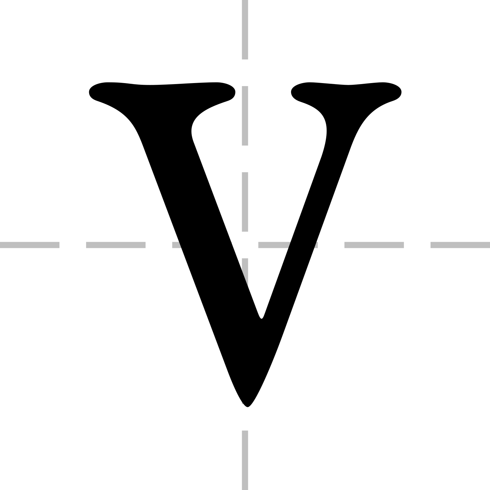

<div align="center">
    <picture>
        <source media="(prefers-color-scheme: dark)" srcset="frontend/public/favicon-dark.svg">
        <source media="(prefers-color-scheme: light)" srcset="frontend/public/favicon-light.svg">
        
    </picture>
    <h1>VaraiX</h1>
    <p>A minimal, deterministic, LLM-friendly chart description language that renders to SVG.</p>
</div>

## What is VaraiX?

VaraiX (`.vix`) is a compact, line-oriented DSL for describing charts. Write a few lines of plain text and get a clean SVG back. The language is implemented in Rust and designed for predictable, deterministic rendering. Recent language additions include fixed-size arrays, ranges, comprehensions, typed arrays, C-style comments, and explicit null handling.

Full documentation for the language (detailed specification, examples, and recipes) is published at: https://varaix.vercel.app/docs — please consult the online docs for the authoritative, versioned reference and extended examples.

## Quick Example (array style)

```vix
chart: line
title: Monthly Revenue

x: month
y: revenue ($k)

myData = [["Jan", 12], ["Feb", 19], ["Mar", 15]]

data: myData
```

You can still use the original block-style data form:

```vix
chart: bar
x: quarter
y: revenue

data:
"Q1", 120
"Q2", 150
"Q3", 170
"Q4", 200
```

## Notable language features (summary)

- Comments: `// single-line`, `/* block */`, and `#` (legacy). Block comments preserve newlines so diagnostics keep correct line numbers.
- Arrays: fixed-size arrays created at parse time. Forms: explicit lists (`[a, b, c]`), ranges (`[1..5]`), comprehensions (`[expr for i in start..end]`).
- Typed arrays: `int[]`, `float[]`, `string[]` — elements coerced at parse time.
- Nulls: `null` or `None` allowed in array literals and data; use `null_fill` to control handling.
- Data: `data:` accepts block-style rows or an array-of-pairs variable / inline array.

## Null fill strategies

Set `null_fill:` to one of:

- `zero` — replace nulls with 0 (default)
- `mean` / `average` — replace with mean of non-null values
- `prev` / `previous` — replace with previous non-null value (or 0 if none)
- `next` / `forward` — replace with next non-null value (or 0 if none)
- `skip` — drop points with null y (affects indexing and axes)

Example:

```vix
null_fill: mean
myData = [["Jan", 10], ["Feb", null], ["Mar", 20]]
data: myData
```

let source = r#"
chart: line
x: month
y: value
myData = [["Jan", 10], ["Feb", null], ["Mar", 20]]
null_fill: mean
data: myData
"#;
let ast = parser::parse(source).unwrap();
let svg = renderer::render(&ast);

```bash
cargo run -- examples/line.vix > out.svg
```

## Running the frontend (dev)

If you want to run the Next.js frontend locally and use the Wasm bindings:

1. Build the wasm package from the Rust crate (requires `wasm-pack`):

```bash
cd /path/to/varaix/frontend
npm run build:wasm:release
```

2. Start the frontend:

```bash
npm ci
npm run dev
```

(There are helper npm scripts in `frontend/package.json` to build wasm and run the app, but running `wasm-pack` manually is explicit and predictable.)

## Examples

See the `examples/` directory for many examples:

- array-of-pairs, block-style data
- null-handling (zero/mean/prev/next/skip)
- typed arrays and ranges

## Project structure

```
varaix/
├── Cargo.toml
├── README.md
├── examples/
└── src/
```

Note: the human-readable spec previously available in `SPEC.md` has been replaced by the consolidated online documentation at the URL above. Use the online docs for the most up-to-date guidance and examples.

## License

This project is licensed under the MIT License - see the [LICENSE](LICENSE) file for details.
